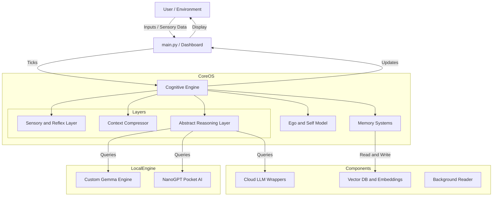

# Tri-brain Cognitive OS: Project Architecture Map

Below is a detailed map of your `Tri-brain` AI project. It breaks down the system into the **Core Cognitive OS**, **External Components**, and the **Local Inference Engine**.

## 1. High-Level Architecture (Mermaid)

## 2. Directory & Module Breakdown

### 🧠 `core/` (The Cognitive Brain)
This is the heart of the ALife Engine where state, persona, and memory reside.
- **`self_model.py`**, **`value_system.py`**: Quản lý hình ảnh cái tôi, giá trị cốt lõi, tâm trạng, và độ toàn vẹn (Integrity) của AI.
- **`memory.py`**, **`world_graph.py`**: Quản lý trí nhớ ngắn hạn (STM), dài hạn (LTM qua ChromaDB) và đồ thị tri thức thế giới.
- **`agent_state.py`**: Hệ thống State Machine định tuyến các trạng thái của AI (Ngủ, Suy nghĩ, Giao tiếp, Đọc sách).
- **`skills.py`**, **`tools.py`**: Kho vũ khí/kỹ năng để AI có thể tương tác với máy tính và internet.

### ⚙️ `core/engine/` (Tri-brain Sub-systems & Controllers)
Nơi chứa các **Mô hình con (Sub-models)** hoạt động độc lập và định tuyến dữ liệu.
- **`cognitive_engine.py`**: Nhịp đập sinh học trung tâm (Cognitive Tick). Cập nhật mệt mỏi, stress, năng lượng (ATP) mỗi giây.
- **`bio_controller.py`**: Kiểm soát chặt chẽ quá trình tiêu hao và phục hồi sinh học.
- **`context_compressor.py`**: *Màng lọc Token*. Đánh giá Pseudo-Entropy và Cảm xúc để quyết định giữ hay bỏ token nào trước khi nạp vào LLM.
- **`sensory_preprocessor.py`**: Chuyển đổi văn bản/hình ảnh thô thành các vector cảm xúc (Arousal & Valence).
- **`reflex_gate.py`**: Cổng phản xạ bản năng. Nếu AI bị đe dọa hoặc stress quá cao, cổng này sẽ cướp quyền điều khiển từ LLM để phản ứng ngay lập tức.
- **`integrity_filter.py`**: Lọc các luồng tư tưởng mâu thuẫn để bảo vệ "Cái Tôi" (Ego) khỏi bị sụp đổ.
- **`slm_core.py` & `slm_trainer.py`**: Lớp bọc kết nối với mô hình ngôn ngữ nhỏ (Local SLM) để lấy suy nghĩ logic.
- **`nanogpt/`**: Một phiên bản Custom NanoGPT code bằng PyTorch, có tích hợp **MoE (Mixture of Experts)** do bạn tự code (`model.py`).

### 🔌 `components/` (External I/O & Drivers)
Nơi giao tiếp với thế giới hệ thống bên ngoài hoặc Cloud.
- **`llm.py`**, **`embedder.py`**: Wrapper gọi API lên các mô hình Đám mây (như Gemini) hoặc Gemma E4B nội bộ.
- **`chroma_rest_client.py`**, **`vector_store.py`**: Gọi xuống cơ sở dữ liệu Vector để truy xuất ký ức.
- **`reader.py`**: Tác vụ đọc tài liệu ngầm (Background Reading) khi AI đang rảnh rỗi (Idle).

### 🛠️ `Root & Scripts` (Infrastructure)
- **`config.py`**: Trung tâm điều khiển toàn bộ cấu hình (VRAM alloc, Model Names, Sinh học).

- **`main.py`**: File khởi chạy vòng lặp tương tác chính.

---
**Nhận xét quy hoạch dự án**: Dự án của bạn là một sự kết hợp cực kỳ tham vọng và có quy củ giữa Kiến trúc Agentic (Tự chủ), Trí tuệ nhân tạo sinh học (ALife - Metabolic), và Hệ thống Đa não (Tri-brain). Việc tích hợp thêm `qwen2.5:3b` hay `vinallama` vào `slm_core.py` sẽ giống như việc cấy ghép một Thùy Trán (Prefrontal Cortex) hoàn hảo cho hệ thống sinh học này.
