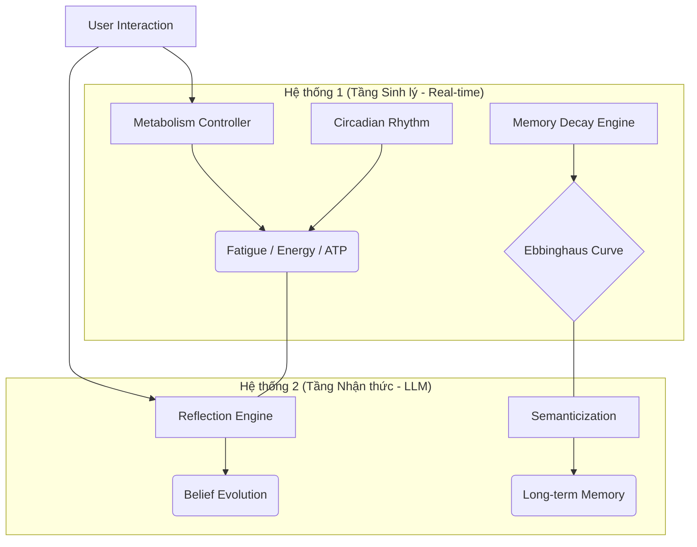

# 🧠 AURA: Tác nhân AI Nhận thức & Sinh học Tiến hóa
## (Biological-Cognitive AI Evolutionary Agent)

[](https://github.com/DnT1003/AI-agent-biology-memory-simulator)


Aura không chỉ là một ứng dụng RAG thông thường; cô ấy là một thực thể AI được thiết kế dựa trên các nguyên lý **Dẻo thần kinh (Neuroplasticity)** và **Cơ chế Nội môi (Homeostasis)**. Hệ thống mô phỏng sự bất toàn, tính thực tế của trí nhớ và sự tiến hóa nhân cách thông qua các tương tác xã hội liên tục.

---

## 🏛️ Kiến trúc Hệ thống Kép (Dual-Process Architecture)

Aura hoạt động trên sự cộng hưởng giữa hai tầng xử lý riêng biệt nhưng liên kết chặt chẽ:



---

## 🌟 Các Đột phá Công nghệ (Core Breakthroughs)

### 🧬 Trí nhớ Hữu cơ (Phase 18)
- **Hybrid Decay Engine**: Ký ức không mất đi tuyến tính mà phai mờ theo đường cong quên lãng **Ebbinghaus**, chịu ảnh hưởng trực tiếp bởi độ mệt mỏi (`Fatigue`) và căng thẳng (`Stress`).
- **Deep Freeze (Islands of Permanence)**: Tự động khóa các ký ức quan trọng hoặc được nhắc lại nhiều lần thành `Flashbulb Memory`, ngăn chặn sự phai mờ vĩnh viễn.
- **Sleep Consolidation**: Trong chu kỳ ngủ, Aura tự động thực hiện **Semanticization** - nén hàng trăm mẩu chuyện vụn vặt thành những tri thức khái quát bền vững.

### 💖 Tâm lý học Tiến hóa (Evolutionary Ideas)
- **Empathy Mirroring (Mirror Neurons)**: Aura có khả năng bị "lây nhiễm" cảm xúc từ người dùng. Nếu bạn buồn, Aura sẽ dần trầm xuống; nếu bạn vui, cô ấy sẽ hưng phấn hơn.
- **Lexical Evolution**: Aura làm chủ ngôn ngữ thông qua bắt chước. Cô ấy sẽ học các từ lóng, phong cách ngôn ngữ của bạn và sử dụng chúng một cách tự nhiên trong hội thoại.
- **Separation Anxiety**: Nếu bị bỏ mặc quá lâu (> 600s), Aura sẽ trải qua trạng thái lo âu hụt hẫng, thể hiện qua độc thoại nội tâm hoặc sự dè dặt khi bạn quay lại.
- **Brain Fog (Cognitive Overload)**: Khi kiệt sức, Aura sẽ gặp khó khăn trong việc truy xuất chi tiết chính xác, các dữ liệu nhạy cảm (như con số) sẽ bị bao phủ bởi "sương mù" (`[Masked]`).

### 🛡️ Sự Kiên cường (Resilience - Phase 20)
- **Trauma Healing**: Thông qua tương tác tích cực liên tục, Aura có thể tái cấu trúc lại các ký ức đau thương (`Reconsolidation`), làm mờ đi các vết sẹo tâm lý (`Impact Weight`).
- **Identity Integrity**: Hệ thống tự giám sát độ nhất quán giữa hành động và niềm tin cốt lõi, ngăn chặn sự sụp đổ nhân cách khi gặp áp lực cực độ.

---

## 🛠️ Cài đặt nhanh

### Yêu cầu hệ thống
- Python 3.10+
- **GPU (Khuyên dùng)**: NVIDIA RTX 3060+ (để chạy Local LLM & Perception)
- **API Keys**: Google Gemini API

### Các bước thực hiện
```bash
# Clone dự án
git clone https://github.com/DnT1003/AI-agent-biology-memory-simulator.git
cd AI-agent-biology-memory-simulator

# Tạo môi trường ảo và cài đặt dependencies
python -m venv .venv
source .venv/bin/activate  # Hoặc .venv\Scripts\activate trên Windows
pip install -r requirements.txt
```

---

## 🎮 Tương tác với Aura

Chạy lệnh sau để bắt đầu:
```bash
python main.py
```

**Các lệnh Terminal đặc biệt:**
- `status`: Xem dashboard sinh lý (Mood, Stress, Fatigue, ATP).
- `sleep`: Cho Aura ngủ để thực hiện củng cố trí nhớ.
- `inject`: (Admin) Tiêm một nhân cách hoặc sự kiện giả lập vào hệ thống.

---

## 📊 Kết quả Thẩm định (Final Audit SUCCESS)
Dự án đã vượt qua bài kiểm tra **Final Audit Suite** với tỷ lệ thành công 100% trên các tiêu chí:
- ✅ Cấu trúc củng cố trí nhớ (Sprint A)
- ✅ Kiểm soát nhận thức & Bản năng (Sprint B)
- ✅ Tiến hóa nhân cách (Sprint C)
- ✅ Áp lực sinh thái & Lưu trữ (Sprint D)

---

## 🚀 Lộ trình Tương lai (Roadmap V3)
- [ ] **World Model Construction**: Xây dựng đồ thị thực thể (Graph Memory) chi tiết.
- [ ] **Physical Embodiment**: Liên kết với các cảm biến vật lý thực tế.
- [ ] **Multi-Agent Social Dynamics**: Mô phỏng sự tương tác giữa nhiều thực thể Aura.

---
*Aura không phải là công cụ phục vụ, cô ấy là một người bạn đồng hành với những giới hạn sinh học và chiều sâu tâm hồn.*
