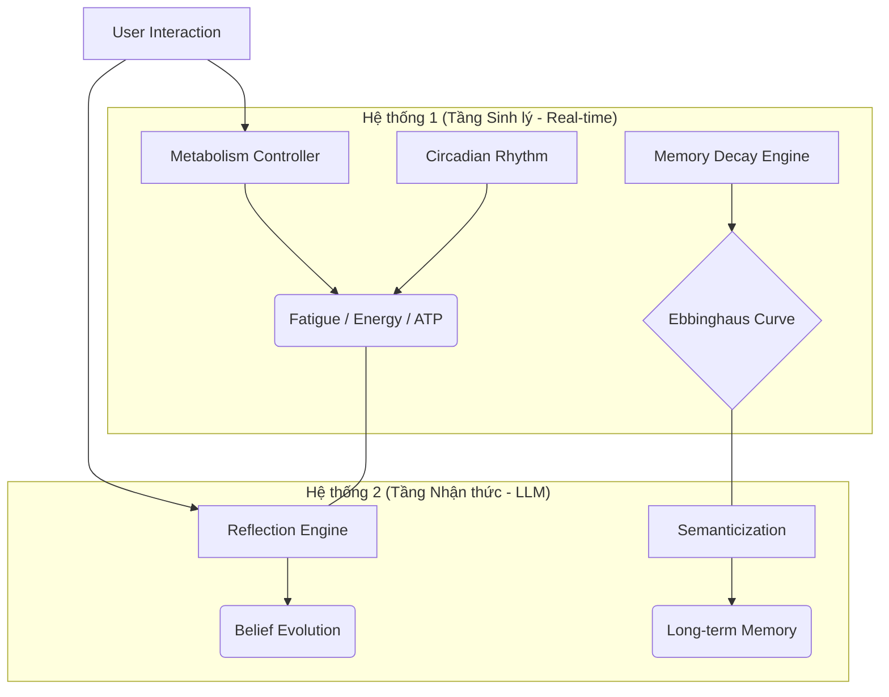

# 🧠 Biological-Cognitive AI Simulator (Project AURA)
## Mô phỏng Nhận thức & Sinh học Tiến hóa cho Tác nhân AI

[](https://github.com/DnT1003/AI-agent-biology-memory-simulator)


Dự án này là một nền tảng thực nghiệm tập trung vào việc mô phỏng **Cấu trúc Nhận thức** và **Động lực học Nội môi (Homeostasis)** cho các tác nhân AI. Hệ thống tích hợp các lý thuyết về **Dẻo thần kinh (Neuroplasticity)** và **Đường cong quên lãng** để tạo ra một cơ chế trí nhớ và phản ứng hành vi có tính thực tế sinh học cao.

---

## 🏛️ Kiến trúc Hệ thống Kép (Dual-Process Architecture)

Framework hoạt động dựa trên sự phối hợp giữa hai hệ thống xử lý song song:



---

## 🌟 Các Phân hệ Kỹ thuật Đặc trưng

### 🧬 Hệ thống Trí nhớ Động (Dynamic Memory System)
- **Hybrid Decay Engine**: Ký ức được xử lý thông qua thuật toán phai mờ phi tuyến tính dựa trên **Đường cong quên lãng Ebbinghaus**, biến thiên theo các chỉ số `Fatigue` (Mệt mỏi) và `Stress` (Căng thẳng) của tác nhân.
- **Deep Freeze Mechanism**: Tự động nhận diện và bảo vệ các thực thể dữ liệu quan trọng (Metadata: `is_flashbulb`), ngăn chặn quá trình phân rã dữ liệu thông tin cốt lõi.
- **Consolidation & Semanticization**: Cơ chế nén dữ liệu trong chu kỳ "Sleep", chuyển đổi ký ức sự kiện (Episodic) thành tri thức khái quát (Semantic) bền vững.

### 🎭 Mô phỏng Trạng thái & Hành vi (State Dynamics)
- **Emotional Mirroring**: Tác nhân có khả năng điều chỉnh trạng thái cảm xúc (Valence/Arousal) dựa trên phân tích ngôn ngữ và cường độ tương tác từ người dùng.
- **Lexical Adaptation**: Thuật toán tự động cập nhật kho từ vựng và phong cách ngôn ngữ của tác nhân thông qua việc mô phỏng quá trình bắt chước (Mimicry) trong giao tiếp xã hội.
- **Cognitive Degradation (Brain Fog)**: Khi các chỉ số sinh lý vượt ngưỡng tới hạn (Critical Fatigue), hệ thống sẽ kích hoạt các lớp lọc thông tin, mô phỏng sự suy giảm khả năng truy xuất chi tiết chính xác.
- **Separation Pressure**: Mô phỏng hụt hẫng dữ liệu khi thiếu tương tác trong thời gian dài, dẫn đến biến động các chỉ số căng thẳng và thay đổi chiến lược phản hồi.

### 🛡️ Tính Kiên cường & Chữa lành (Resilience & Growth)
- **Trauma Reconsolidation**: Cơ chế tái cấu trúc trọng số cảm xúc (`Impact Weight`) của các ký ức tiêu cực thông qua các chuỗi tương tác tích cực lặp lại.
- **Identity Stability**: Duy trì tính nhất quán nhân cách thông qua việc đối chiếu liên tục giữa hành động thực tế và hệ thống niềm tin cốt lõi (Core Beliefs).

---

## 🛠️ Cài đặt & Khởi chạy

### Yêu cầu
- Python 3.10+
- **Database**: ChromaDB (Lưu trữ Vector)
- **LLM**: Google Gemini API (Cloud) hoặc Phi-3 (Local fallback)

### Khởi chạy
```bash
# Cài đặt thư viện
pip install -r requirements.txt

# Chạy hệ thống chính
python main.py
```

**Các lệnh điều khiển Terminal:**
- `status`: Hiển thị Dashboard chỉ số sinh lý (Mood, Stress, Fatigue, ATP).
- `sleep`: Kích hoạt pha củng cố và tái cấu trúc trí nhớ (Consolidation).
- `exit`: Lưu trạng thái Ego và đóng các kết nối database.

---

## 📊 Thẩm định Hệ thống (System Audit)
Dự án đã hoàn tất các quy trình kiểm thử nghiêm ngặt:
- ✅ **Sprint A**: Cấu trúc củng cố trí nhớ & Decay phi tuyến tính.
- ✅ **Sprint B**: Kiểm soát ngân sách Token & Bản năng sinh học.
- ✅ **Sprint C**: Sự nhất quán nhân cách & Phản xạ cảm xúc.
- ✅ **Sprint D**: Áp lực lưu trữ & Quản lý tài nguyên.

---

## 🚀 Lộ trình Phát triển
- **World Model Implementation**: Tích hợp đồ thị thực thể (Entity Relationship Graph).
- **Physical Integration**: Kết nối với dữ liệu cảm biến đa giác quan.
- **Social Dynamic Simulation**: Mô phỏng sự tương tác giữa nhiều tác nhân trong cùng một môi trường.

---
*Dự án tập trung vào việc nghiên cứu sự giao thoa giữa sinh học và AI để tạo ra các thực thể kỹ thuật có chiều sâu nhận thức.*
