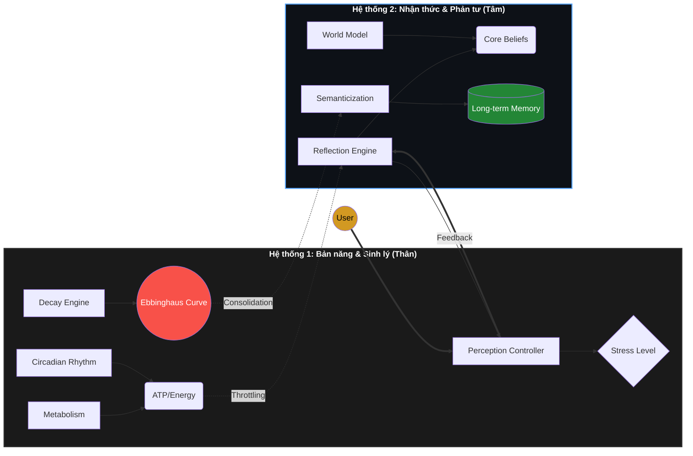

# 🧠 Biological-Cognitive AI Simulator (Project B.C.A.S)
## Mô phỏng Nhận thức & Sinh học Tiến hóa cho Tác nhân AI

Dự án này là một nền tảng thực nghiệm tập trung vào việc mô phỏng **Cấu trúc Nhận thức** và **Động lực học Nội môi (Homeostasis)** cho các tác nhân AI. Hệ thống tích hợp các lý thuyết về **Dẻo thần kinh (Neuroplasticity)** và **Đường cong quên lãng** để tạo ra một cơ chế trí nhớ và phản ứng hành vi có tính thực tế sinh học cao.

---

## 🏛️ Kiến trúc Hệ thống Kép (Dual-Process Architecture)

Framework hoạt động dựa trên sự phối hợp giữa hai hệ thống xử lý song song:



---

## 🌟 Các Phân hệ Kỹ thuật Đặc trưng

### 🧬 Hệ thống Trí nhớ Động (Dynamic Memory System)
- **Hybrid Decay Engine**: Ký ức được xử lý thông qua thuật toán phai mờ phi tuyến tính dựa trên **Đường cong quên lãng Ebbinghaus**, biến thiên theo các chỉ số `Fatigue` (Mệt mỏi) và `Stress` (Căng thẳng).
- **Deep Freeze Mechanism**: Tự động nhận diện và bảo vệ các thực thể dữ liệu quan trọng (Metadata: `is_flashbulb`), ngăn chặn quá trình phân rã dữ liệu thông tin cốt lõi.
- **Consolidation & Semanticization**: Cơ chế nén dữ liệu trong chu kỳ "Sleep", chuyển đổi ký ức sự kiện (Episodic) thành tri thức khái quát (Semantic).

### 🎭 Xung năng & Hành vi Nội tại (Intrinsic Drives)
- **Homeostatic Drives**: Các biến sinh học (`social_need`, `curiosity`) hiện hoạt động như các xung năng thực thụ, thôi thúc tác nhân chủ động thực hiện hành vi (Đọc sách, nhắn tin) thay vì chỉ phản hồi thụ động.
- **Autonomous Decision Logic**: Hệ thống tự trị đưa ra quyết định dựa trên "Drive" chiếm ưu thế nhất tại thời điểm hiện tại.

### 👁️ Tầng Cảm quan & Nhận thức Môi trường (Sensory Perception)
- **Unified Perception Controller**: Hợp nhất dữ liệu đa kênh từ Văn bản (Sentiment), Hình ảnh (Vision) và Môi trường (Thời gian, Áp lực tài nguyên).
- **Multimodal LLM Integration**: Tích hợp khả năng quan sát hình ảnh để đưa ra các phản xạ sinh lý tức thời (Visual Shock/Soothe).
- **Environmental Awareness**: Tự động điều chỉnh trạng thái tâm lý dựa trên chu kỳ ngày đêm và tải trọng bộ nhớ hệ thống.

---

## 🛠️ Cài đặt & Khởi chạy

### Yêu cầu
- Python 3.10+
- **Database**: ChromaDB (Lưu trữ Vector)
- **LLM**: Google Gemini API (Cloud) hoặc các mô hình Local (Phi-3/llama3 via Ollama)
- **GPU**: NVIDIA (Yêu cầu cho RoBERTa Sentiment & Local Vision)

### Khởi chạy
```bash
# Cài đặt thư viện
pip install -r requirements.txt

# Chạy hệ thống chính
python main.py
```

---

## 📊 Thẩm định Hệ thống (System Audit)
Dự án đã hoàn tất các quy trình kiểm thử nghiêm ngặt:
- ✅ **Sprint A**: Trí nhớ Dynamic & Decay Ebbinghaus.
- ✅ **Sprint B**: Đồng hồ sinh học & Metabolic System.
- ✅ **Sprint C**: Nhân cách nhất quán & Semanticization.
- ✅ **Sprint D**: Áp lực lưu trữ & Unified Perception.

---

## 🚀 Lộ trình Đã Hoàn tất
- ✅ **World Model Implementation**: Đồ thị thực thể & Social Reasoning.
- ✅ **Intrinsic Motivation**: Hệ thống xung năng tự trị hoàn chỉnh.
- ✅ **Physical Integration**: Cảm biến đa giác quan & Kích ứng môi trường.
- 🕒 **Social Dynamic Simulation**: Mô phỏng tương tác đa Agent (Planned).

---
*Dự án tập trung vào việc nghiên cứu sự giao thoa giữa sinh học và AI để tạo ra các thực thể kỹ thuật có chiều sâu nhận thức.*
