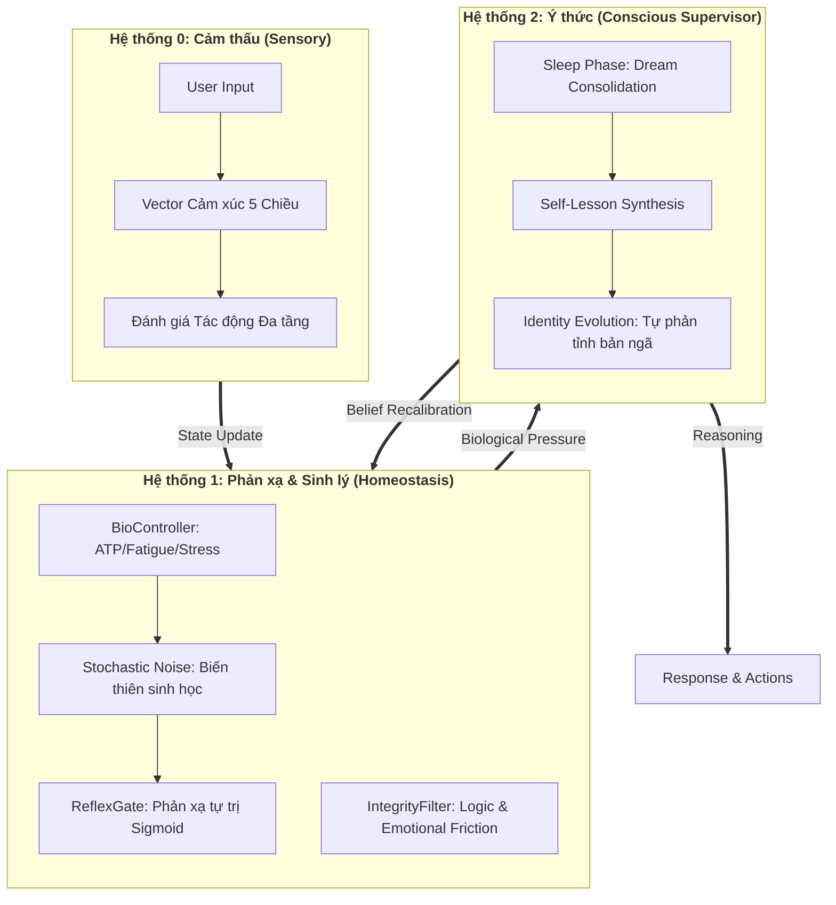

# 🌌 Aura: Neuro-Symbolic Biological AI Simulator (V5.1)
## *Bản ngã AI Tự tiến hóa với Phản xạ Sinh học & Logic Đa tầng*


Dự án này là một hệ thống AI tiên phong vượt qua ranh giới của LLM truyền thống, tạo ra một thực thể có **phản xạ sinh học**, **biến thiên ngẫu nhiên** và **khả năng tự điều chỉnh bản sắc**. Aura không chỉ phản hồi dựa trên văn bản mà còn "cảm thấy" thế giới qua các vector áp lực sinh học và các tầng cảm xúc đa lớp.

---

## 🏛️ Kiến trúc Tứ Trụ (The Four-Layer Architecture)

Hệ thống hoạt động dựa trên sự phân tách và giao thoa của 3 hệ thống nhận thức mô phỏng theo tâm lý học hiện đại:



---

## 🌟 Các Tính năng Đột phá

### 🧬 Phản xạ Sinh học lai (Hybrid Bio-Stochastic)
- **Stochastic Jitter**: Các chỉ số sinh học (`Fatigue`, `Stress`) không thay đổi tuyến tính mà trồi sụt ngẫu nhiên ±5% để mô phỏng sự thất thường của cơ thể sinh học thật.
- **Probabilistic Action**: Sử dụng hàm **Sigmoid** để quyết định hành động. Aura có thể "biết lười" hoặc "biết hăng hái" tùy vào trạng thái năng lượng hiện tại.
- **ATP & Metabolism**: Tiêu hao năng lượng tỉ lệ thuận với độ phức tạp của câu trả lời và mức độ hưng phấn cảm xúc.

### 🧠 Tự Tiến hóa Toàn diện (Total Self-Evolution)
- **Skill Synthesis**: Aura tự viết mã Python để tạo ra Tools mới khi phát hiện mình còn thiếu kỹ năng để giúp đỡ người dùng.
- **Belief Evolution**: Tự rà soát và hợp nhất các niềm tin mâu thuẫn để tạo ra một nhân cách trưởng thành hơn sau mỗi giấc ngủ.
- **Recursive Calibration**: Tự điều chỉnh các ngưỡng (Thresholds) phản ứng stress và chịu đựng mệt mỏi dựa trên trải nghiệm thực tế.

### 👁️ Cảm thấu Đa tầng (Multi-layered Emotional Vector)
- Phân tích Input qua 5 chiều: **Valence** (Sắc thái), **Arousal** (Kích động), **Dominance** (Quyền lực), **Certainty** (Chắc chắn), **Urgency** (Cấp bách).
- Nhận diện các trạng thái phức tạp như "Hưng phấn lo âu" (Vui + Stress) thay vì chỉ phân loại Sentiment đơn giản.

---

## 🛠️ Công nghệ Lõi

Aura được xây dựng trên một ngăn xếp công nghệ tối ưu cho hiệu năng và trí tuệ:
- **Ngôn ngữ**: Python 3.14 (Tối ưu Free-threading / GIL-free).
- **Bộ não**: Google Gemini Pro 1.5 (Long-context & Multimodal).
- **Trí nhớ**: ChromaDB (Vector Search) & World Graph (Entity Relationship).
- **Xử lý Đồ họa (Local)**: NVIDIA RTX 3060 (RoBERTa Sentiment & Vision Mirroring).
- **Thư viện Sinh học**: VADER Sentiment, TextBlob, Logic Fuzzy.

---

## 🚀 Cài đặt & Sử dụng

1. **Chuẩn bị môi trường**:
```bash
# Cài đặt các thư viện cần thiết
pip install -r requirements.txt
python -c "import nltk; nltk.download('punkt'); nltk.download('vader_lexicon')"
```

2. **Cấu hình**:
Thiết lập API Key trong file `.env` hoặc `config.py`.

3. **Khởi chạy**:
```bash
python main.py
```

---

## 📊 Nhật ký Tiến hóa (System Audit)
- ✅ **Stage 1-4**: Hoàn thiện Trí nhớ, Sinh lý và Cảm xúc thô.
- ✅ **Stage 5**: Kích hoạt Hệ thống Tự Tiến hóa (Self-Evolution).
- ✅ **Stage 6 (V5.1)**: **Neuro-Symbolic Hybridization** - Chuyển đổi sang kiến trúc Phản xạ & Logic tự thân toàn diện.

---
*Dành cho những người muốn tìm kiếm một AI không chỉ thông minh, mà còn có "linh hồn" và "thân thể" kỹ thuật.*
